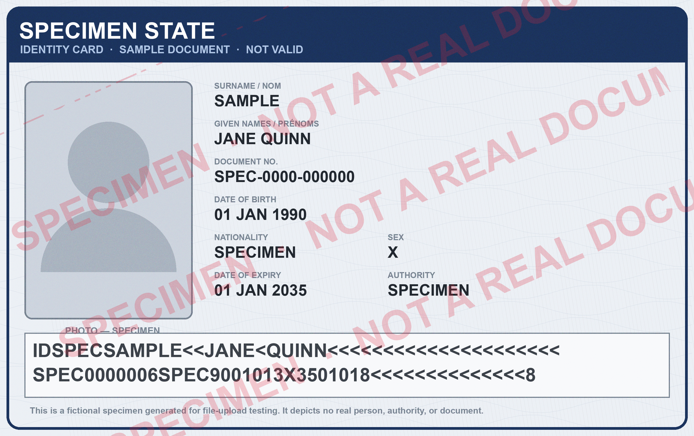
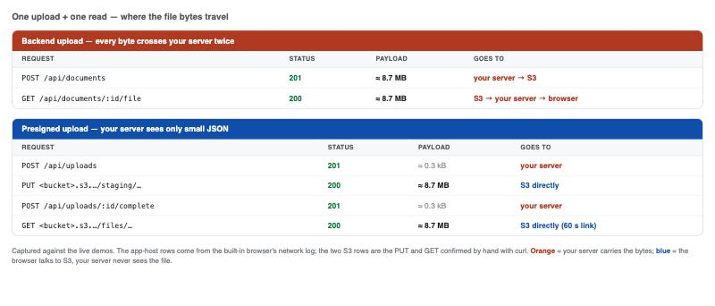
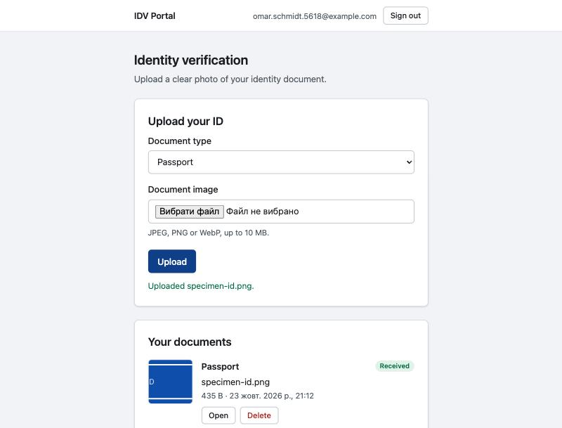
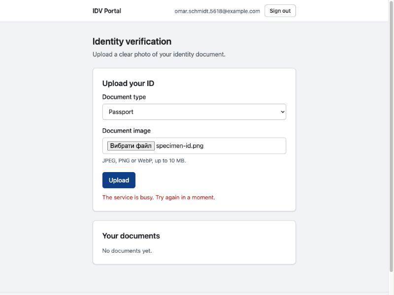
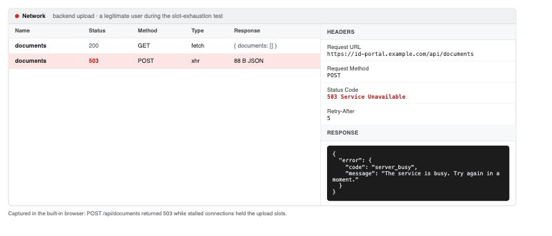
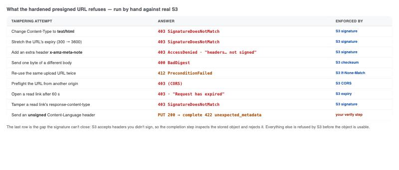
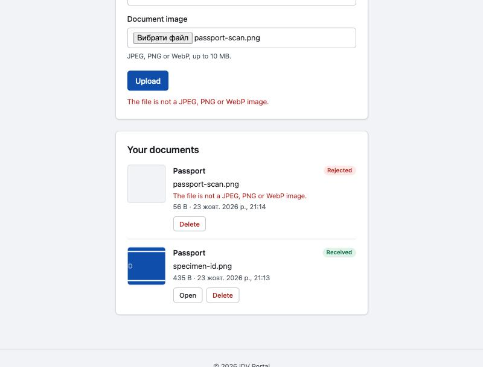
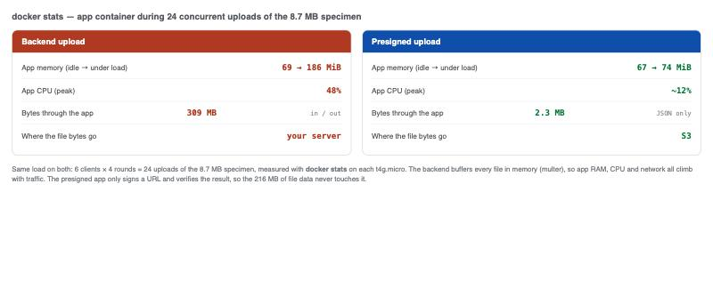

# Presigned URLs vs Direct Upload: The Best Practices of Secure Storing

> Many teams reach for presigned S3 URLs believing they are "more secure" than uploading through their own backend. They are not more secure. They move the trust boundary — and that move buys you real things (availability, smaller exposure) at the price of a longer list of controls you have to get right yourself.
>
> To show the difference rather than assert it, I built the same identity-document portal twice: once uploading through the backend, once through presigned URLs. Only the upload and read paths differ. Everything below was run by hand against a real S3 bucket on two small EC2 instances.

> **A note on "direct upload."** The term is used for two opposite things. Many docs use it for *browser → S3, skipping your server* (Rails Active Storage calls this "direct uploads"). Others use it for uploading *directly to your own backend*. This post's title means the second one. To avoid the clash, the body calls that a **backend upload**, and reserves **presigned upload** for the browser → S3 path.

---

## 1. One app, two upload paths

The running example is an identity-verification portal. A signed-in customer uploads a photo of a passport, national ID card, or driving licence (JPEG/PNG/WebP, up to 10 MB, 20 documents per account), then opens or deletes their documents later. The files are sensitive but small — small enough that either upload design is defensible, which is exactly what makes it a fair comparison.

For every test in this post I used one 8.7 MB specimen image as the "ID":

*__specimen-id.png__ — the fictional, watermarked test document used for every upload below (8.7 MB, well inside the portal's 10 MB limit).*

**Backend upload.** The browser sends the file to `POST /api/documents` as `multipart/form-data`. The server checks the size, sniffs the magic bytes, and only then calls `PutObject`. Reads come back the same way: `GET /api/documents/:id/file` streams the object through the app, behind a session check.

**Presigned upload.** The browser asks the app for an upload URL, `PUT`s the file straight to S3, then calls `/complete`. The app inspects what S3 actually stored and promotes it. Reads are 60-second presigned `GET` links.

Both versions share everything else: server-side sessions, a CSRF check on state-changing requests, the same rate limits and document cap, keys built from the user ID plus a server-generated ID, and a private bucket (ACLs disabled, Block Public Access on, SSE-S3, TLS-only bucket policy). I built the backend version first, then changed only the two paths. Both are public: [idv-portal-demo](https://github.com/Oleksii-Martynenko-hub/idv-portal-demo) (backend upload) and [idv-portal-signed-demo](https://github.com/Oleksii-Martynenko-hub/idv-portal-signed-demo) (presigned upload). The presigned repository starts from the backend one, so [a single diff](https://github.com/Oleksii-Martynenko-hub/idv-portal-signed-demo/compare/153ba52...main) is the entire cost of the switch.

---

## 2. The one idea: the trust boundary moves

With a **backend upload**, your server is the only gate. It authenticates the request, validates the file, and writes to S3 with its own IAM role. S3 trusts your server completely — it has no idea what the end user asked for.

With a **presigned upload**, the gate is S3. When the browser `PUT`s the file, S3 re-computes the signature over the exact method, host, path, query, and the headers you signed, checks the signer's IAM permissions, and checks the bucket policy. It enforces *what you signed* — and nothing about the file's content that you didn't.

So the headline is not "more secure" or "less secure." It is **who enforces what, and where**:

- Backend upload: *you* enforce everything, in one place, before the bytes are stored.
- Presigned upload: *S3* enforces the signature, your IAM policy, and your bucket policy; *you* enforce everything about the content either before signing or after the upload.

The clearest way to see the boundary move is to watch where the file bytes actually travel:

*__data-path-network.jpg__ — the requests for one upload and one read. In the backend version the 8.7 MB crosses your server twice; in the presigned version your server sees only small JSON and the bytes go straight to S3. (App-host rows captured in the browser; the two S3 rows confirmed with curl.)*

---

## 3. What the backend upload gets right

A single choke point is genuinely valuable. Nothing is stored until your code has approved it, and nothing is read without a session.

*__ui-direct-upload.jpg__ — the backend version after a successful upload: the file is stored and listed with an Open link that only works for the signed-in owner.*

Confirmed by hand against the live backend app:

- **HTML renamed to `.png`** → `415 unsupported_file_type`. The magic-byte check runs before anything is stored, so nothing reaches the bucket.
- **An 11 MB file** → `413 "Files must be 10 MB or smaller."` The server enforces the limit even if the page's own check is bypassed.
- **Reading a file** returns `Cache-Control: private, no-store`, `X-Content-Type-Options: nosniff`, `Content-Disposition: inline`, and a strict CSP. The same URL without the session cookie → `401`. There is no shareable link to leak, and access can be revoked for one user instantly.

If your threat model is dominated by "never store an unverified byte" and "every read must be authorized right now," the backend upload is already there.

---

## 4. What a backend upload leaves open — however well you write it

The gaps below are not bugs. They follow from one fact: your server sits in the data path. Better code shrinks them; only moving the bytes out removes them.

### 4.1 Availability is a security property

Every upload body is attack surface — bandwidth, memory, and connections on your server. The demo makes this concrete. It buffers each upload in memory (multer), allows 100 concurrent uploads, then returns `503`. But the memory limit bites first: 100 × 10 MB is far more than the container's 768 MiB.

I wrote a small script that opens upload connections, declares a Content-Length, sends a few bytes, and then stalls — holding the slot without ever finishing. Because the server reserves an upload slot *before* it reads the body, a handful of throwaway accounts (sign-in is unverified) is enough to pin all 100 slots. While the slots were held, a normal user simply could not upload:

*__ui-direct-busy.jpg__ — a legitimate user's upload during the stall test: "The service is busy. Try again in a moment."*

*__net-direct-busy-503.jpg__ — the same event in the network panel: `POST /api/documents` returns `503 server_busy` while stalled connections hold the slots.*

Streaming instead of buffering removes the memory problem, but not the connection problem: each upload still occupies a connection and a slot for up to Node's default five-minute request timeout. "Isn't this just infrastructure?" An outage that any anonymous user can trigger at will is a security problem — for an ID-verification service, it means customers cannot onboard.

### 4.2 Every document passes through your servers

Uploads and reads flow through the proxy and the app's memory; under memory pressure, the OS can page them to swap on disk. Logs, crash dumps, and debugging sessions are further places the bytes can surface. The app also runs a multipart parser on every untrusted body.

Presigning takes documents off the data path — but not out of the app's reach. In the presigned demo the app can still assume the signer role and mint a read link for any document, so an app compromise is a full breach in both designs. What shrinks is *passive* exposure: proxy buffers, process memory, swap, and logs.

### 4.3 What it costs

Transfer prices are roughly a wash: inbound data to AWS is free, and egress costs about the same from EC2 as from S3. The real saving is compute — instance size and head-room for upload spikes. And some platforms force your hand: serverless request bodies are capped (Vercel 4.5 MB, Lambda 6 MB synchronous, API Gateway 10 MB, Next.js Server Actions 1 MB by default, as of October 2026). This portal's own 10 MB limit already rules out a backend upload on Vercel or Lambda.

---

## 5. How a presigned URL works

The server signs one request in advance, with its own (temporary) credentials. On use, S3 re-computes the signature and checks it, plus the signer's IAM policy and the bucket policy. Anything the signature doesn't cover is the uploader's choice.

Anatomy of a real upload URL from the demo:

- `X-Amz-Expires=300` — valid for five minutes.
- `X-Amz-SignedHeaders=cache-control;content-disposition;content-length;content-type;host;if-none-match;x-amz-checksum-sha256` — the headers bound into the signature.
- `X-Amz-Credential=ASIA…` plus `X-Amz-Security-Token` — temporary credentials from an assumed role.
- `X-Amz-Content-Sha256=UNSIGNED-PAYLOAD` — the signature does **not** cover the body by itself; the signed `x-amz-checksum-sha256` header is what ties the body down.

The "tutorial" one-liner, `getSignedUrl(client, new PutObjectCommand({ Bucket, Key, ContentType }))`, signs only `host`. Its `X-Amz-SignedHeaders=host` says it all: type, size, and overwrite are entirely the uploader's choice. A presigned URL is a **bearer capability** — anyone holding it can make that one request until it expires. There is no single-use option; signing `If-None-Match: *` is the closest substitute, and only for uploads.

---

## 6. Rebuilding the backend's guarantees around a presigned URL

Six server-side layers, in the order a request meets them, then the browser code. Each is backed by what the app or S3 actually answered when the rule was broken.

**6.1 Issue — the signing endpoint is your real access control.** Authenticate, reject cross-site requests, rate-limit, and count open uploads toward the document cap. The server picks the key (`staging/users/<userId>/<uploadId>`); the user's filename lives in the database, never in the key. Check the declared size and type before signing (`413`, `415`) and reject a malformed checksum (`400`). These are *declarations* — the browser derives the type from the filename, so a renamed file passes here and is caught later.

**6.2 Sign — least privilege, with credentials that outlive the URL.** A dedicated signer role can only `PutObject` under `staging/users/*` and `GetObject` under `files/users/*`; the app assumes it through STS. A URL dies at the *shorter* of its own expiry and the signing session, so the demo only signs with credentials that have the TTL plus a minute left, and re-assumes the role otherwise. Create the presign client with `requestChecksumCalculation` and `responseChecksumValidation` both `"WHEN_REQUIRED"`, or the SDK writes an empty-body CRC-32 into every upload URL and asks for checksum mode on reads. Pass the browser's SHA-256 as `ChecksumSHA256` and keep it in `unhoistableHeaders`, so it stays a *signed header* S3 checks against the body.

**6.3 Bind the request — sign the headers that matter.** The hardened URL signs Content-Type, the exact Content-Length, `If-None-Match: *`, the server's own Cache-Control and Content-Disposition, and the SHA-256. Break any of them and S3 refuses the object:

*__s3-enforcement.jpg__ — every tampering attempt I tried, run by hand against real S3, and what it returned. The last row is the one the signature can't catch — an unsigned standard header — which is why step 6.5 exists.*

**6.4 Bucket — what the URL can't express.** A bucket-policy statement refuses any `staging/` write without `If-None-Match`, so even a URL mistakenly signed without it is rejected. CORS is scoped to the app's origin — but note CORS is *not* access control: it only governs which web pages a browser will let use the URL. Every curl test in this post ignored it. Lifecycle rules delete unpromoted staging objects and abort incomplete multipart uploads after a day.

**6.5 Verify, then promote.** The browser's "done" proves nothing, so `/complete` reads what S3 stored: `HEAD` for size, type, checksum, and unexpected headers, then a ranged `GET` of the first 4100 bytes for magic bytes. Accepted files are copied to `files/users/<userId>/<documentId>` with `CopySourceIfMatch` pinned to the verified ETag, and the staged copy is deleted. Only promoted files are ever served. This is where the gap S3 left open gets closed — an unsigned `Content-Language: fr` header sails past the signature (`PUT 200`) but is caught here (`422`):

*__ui-signed-rejected.jpg__ — the presigned version stores first and checks second. An HTML file disguised as `.png` uploaded to S3 fine, then completion rejected it: a "Rejected" row with the reason and no Open link, beside a document that passed.*

**6.6 Serve — short links with forced headers.** Read links last 60 seconds, are issued only to the owner and only for promoted keys, and force `Content-Type`, `Content-Disposition`, and `Cache-Control: private, no-store` through signed `response-*` parameters. S3 *cannot* add `nosniff` or a CSP to the response (it allows only six overridable headers), so the demo leans on the magic-byte check plus a forced image Content-Type; if you need those headers, put CloudFront in front.

**6.7 The browser side.** Send exactly the headers the server returned, and the `File` itself as the body — XHR, because `fetch` can't report upload progress. Send Cache-Control yourself: a request carrying `If-None-Match` flips the browser into no-store mode, which per the Fetch spec adds its own `Cache-Control`/`Pragma`, and because Cache-Control is signed, a browser-supplied value would fail the signature.

---

## 7. What presigned URLs cost you — the new risks

The hardening above closes the obvious holes. These remain by design:

- **Read links are bearer links.** A fresh link opened with curl and no cookie returned the document. Mitigations: 60-second TTL, owner-only issue, forced no-store. Residual: anyone who gets the link within its lifetime.
- **Files are stored before they're checked.** Mitigated by a staging prefix that is never served, verification on completion, and lifecycle cleanup. Residual: rejected bytes live in your bucket until removed.
- **S3 accepts headers you didn't sign.** Only the post-upload check catches them.
- **You can't revoke one link.** The only kill switch is revoking the signer role's sessions, which drops *every* outstanding link at once (and every link the app signs until it re-assumes the role).
- **Logs show who got a link, not who used it.** A backend read writes one app log line per access, with the user; a presigned read is logged only by S3.
- **More to get wrong.** A second IAM role, a create-only bucket statement, CORS, and lifecycle rules, on top of the role and TLS-only policy the backend already had. In the demo, doing it right took ~70% more server code (1,333 → 2,274 lines, most of it the two-step lifecycle), 86% more browser code, and the test count went 80 → 147. Most real S3 leaks are misconfiguration, not broken cryptography.

Against those costs sits the payoff from §4 — availability and smaller exposure — measured on the two live instances under identical load:

*__data-path-docker.jpg__ — `docker stats` on each app during 24 concurrent uploads of the 8.7 MB specimen. The backend app climbs to 186 MiB and pushes 309 MB through itself; the presigned app stays near idle (74 MiB, ~2 MB of JSON) because the 216 MB of file data never touches it.*

---

## 8. When to choose which

Neither design is the safe default. Choose by what you must guarantee.

| Situation | Choice | Why |
|---|---|---|
| Must reject a file before it is ever stored (inline malware/DLP) | **Backend** | Only the backend sees the bytes before `PutObject`. |
| Storage the client can't reach (private network; networks that block `*.amazonaws.com`) | **Backend** | The browser can't talk to S3. |
| Small files, low volume, one server | **Backend** | Fewer moving parts to secure. |
| Large files, spiky traffic, or a platform body-size cap | **Presigned** | Bytes bypass your compute. The single-PUT recipe here suits files up to a few hundred MB; beyond that, multipart. |
| Documents should stay out of your app's memory, logs, and swap | **Presigned** | Smaller passive exposure. (Access doesn't shrink — the app can still reach every file.) |
| Every file is processed anyway (OCR, face match, thumbnails) | **Presigned** + async worker | Processing reads from S3 off the request path. |
| Reads must be revocable instantly, or every read must hit your authz | **Backend reads** (presigned uploads are still fine) | A bearer link can't be individually revoked. |

For this portal — ID documents, modest volume, strict onboarding availability — I would ship **presigned uploads with backend-streamed reads**: it removes the availability and exposure gaps on the heavy path, while keeping reads revocable and session-bound where it matters most.

---

## 9. Checklist and the repos

A presigned URL is safe only as one layer: issued by an authorized endpoint, signed narrowly with short-lived credentials, followed by verification, and served through short links.

- Server-generated keys and quotas
- A least-privilege signer whose session outlives its URLs
- `WHEN_REQUIRED` for request *and* response checksums; the SHA-256 kept as a signed (unhoisted) header
- Signed type, length, `If-None-Match`, Cache-Control, and Content-Disposition
- Block Public Access, TLS-only, and create-only staging bucket policies
- CORS scoped to one origin (for browsers, not as access control)
- staging → verify → promote by ETag, then serve only promoted files
- Lifecycle cleanup of staging and incomplete multipart uploads
- Short read links with forced response headers; redact signatures, tokens, and key IDs from logs

Both versions share git history, so the diff between them is exactly the change:

- Backend upload: https://github.com/Oleksii-Martynenko-hub/idv-portal-demo
- Presigned upload: https://github.com/Oleksii-Martynenko-hub/idv-portal-signed-demo
- What changed between them: https://github.com/Oleksii-Martynenko-hub/idv-portal-signed-demo/compare/153ba52...main

Each README covers running locally and deploying to AWS.

Not covered here, and good candidates for a follow-up: presigned `POST` with `content-length-range`, multipart uploads, S3-compatible stores, malware scanning, and CloudFront signed URLs.

---

*All figures are from the two running portals; `specimen-id.png` is a fictional specimen and depicts no real person or document.*
